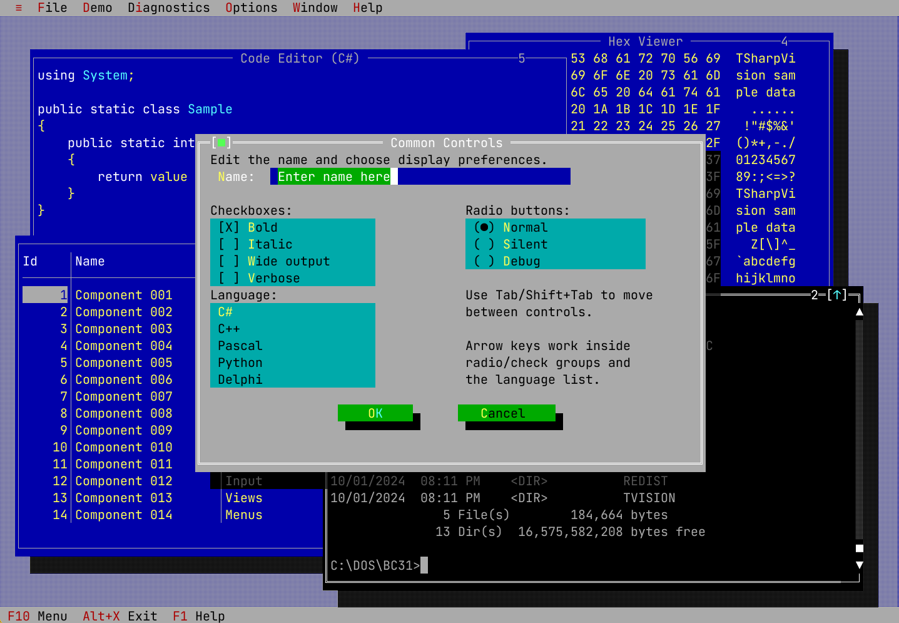

# T# Vision

**Turbo Vision, reimagined for modern .NET.**

[](https://github.com/lubomirklimes/TSharpVision/actions/workflows/ci.yml)
[](https://www.nuget.org/packages/TSharpVision)
[](LICENSE)

T# Vision is a text-mode UI framework for C# and .NET 10, with Turbo Vision-style windows, dialogs, menus, editors and keyboard-driven interaction. You write the application once against the core framework and choose how it is displayed: a native Windows console, an ANSI terminal on Linux/macOS, or an SDL graphical window.



*TVDemo: syntax-highlighted code editor, hex viewer, paged table, embedded terminal and a classic dialog in one character-cell desktop.*

## Why T# Vision?

- **Keyboard-first, classic UI.** Overlapping windows, menus, a status line, dialogs, hotkeys and mnemonics, with mouse support where the host provides it. Familiar concepts such as owner/group routing, commands and palettes are kept; see [Turbo Vision compatibility](docs/compatibility/turbo-vision-compatibility.md) for what is and is not promised.
- **Modern C# and .NET.** Targets `net10.0`, uses Unicode text and managed ownership, and tracks nullable-annotated public APIs against a public API baseline.
- **One application, several drivers.** Console, ANSI terminal and SDL drivers render the same cell grid, and core includes a headless `NullDriver`.
- **Composable controls.** Input lines, list boxes, checkboxes and radio buttons, history lists, file and directory dialogs, message and input boxes, and editors. Version 1.1 adds [`TComboBox`](docs/views/combo-box.md), [`TProgressBar`](docs/views/progress-bar.md) and [`TGroupBox`](docs/views/group-box.md).
- **Customizable look.** Palette-based colors, a color dialog for live palette edits, and font and font-fitting settings for the SDL drivers.
- **Optional extensions.** A TextMate-based code editor, paged hex and table views, and a terminal widget with ConPTY, POSIX PTY and pipe sessions.
- **Headless-friendly.** `NullDriver` lets core run without an interactive host, which is useful for automated tests and tooling.

## One framework, multiple drivers

| Driver | Package | Where it runs |
|---|---|---|
| `Win32ConsoleDriver` | `TSharpVision.Drivers.Console` | An attached Windows console, including Windows Terminal |
| `AnsiTerminalDriver` | `TSharpVision.Drivers.Terminal` | Interactive UTF-8 Linux/macOS terminals with xterm-style ANSI support |
| `SDLDriver` / `SDLGpuDriver` | `TSharpVision.Drivers.SDL` | A desktop window on Windows, Linux or macOS, using SDL3's renderer or GPU path |
| `NullDriver` | `TSharpVision` | Headless, with no interactive input |

Behavior is not identical everywhere: available keys, modifiers and mouse reports depend on the host and terminal emulator, and SDL needs a display, native runtime assets and a usable monospace font. `SDLGpuDriver` is the preferred SDL driver, but a failed GPU initialization does not guarantee fallback. [Drivers](docs/drivers.md) explains selection and limits, and [Platform Support](docs/platform-support.md) separates available packages from tested runtime behavior.

On macOS, the SDL drivers render at the display's native Retina resolution and report Command as the Meta modifier (`kbMetaShift`). In a terminal, which modifier and function-key combinations arrive depends on the emulator: terminals that support the Kitty keyboard protocol, such as iTerm2, can report more than Apple Terminal, which cannot send every combination distinctly.

## See it in action

The repository includes sample applications you can run from a clone with the .NET 10 SDK:

| Sample | What it shows |
|---|---|
| [TVDemo](samples/TSharpVision.Samples.TVDemo) | The main showcase: dialogs and controls, file dialogs, palettes, a character map, the code editor, hex and table views, terminal windows, diagnostics and small games |
| [TVEdit](samples/TSharpVision.Samples.TVEdit) | A standalone multi-window text editor built on `TEditorApp` (Windows Console driver) |
| [TVTerm](samples/TSharpVision.Samples.TVTerm) | Terminal windows hosted on a T# Vision desktop, using the Terminal extension |
| [TVIntl](samples/TSharpVision.Samples.TVIntl) | Localization with string resources, runtime language switching and explicit file encodings |

```shell
dotnet run --project samples/TSharpVision.Samples.TVDemo
```

Run samples in an interactive console or terminal, not an IDE output pane.

## Quick Start

In a Windows console, create a project and install the Console driver:

```shell
dotnet new console -n HelloTSharpVision -f net10.0
cd HelloTSharpVision
dotnet add package TSharpVision.Drivers.Console
```

Replace `Program.cs` with:

```csharp
using System;
using TSharpVision;
using TSharpVision.Constants;

Environment.SetEnvironmentVariable("TSHARPVISION_DRIVER", "Win32ConsoleDriver");
return TSharpVisionRuntime.Run(() => new HelloApp(), "Hello TSharpVision");

sealed class HelloApp : TApplication
{
    public HelloApp()
    {
        var window = new TWindow(new TRect(2, 2, 52, 10), "Hello", Views.wnNoNumber);
        window.Insert(new TStaticText(new TRect(2, 2, 46, 4),
            "Hello from TSharpVision! Alt+X exits."));
        DeskTop.Insert(window);
    }
}
```

Run `dotnet run`. You should see a window with a greeting; press **Alt+X** to exit. Use an interactive console, not an IDE output pane or redirected input/output. For Linux/macOS or a graphical window, choose the package and driver shown in [Drivers](docs/drivers.md); select the driver before starting the runtime.

## Requirements

Use the **.NET 10 SDK** to build (`net10.0`) and a matching .NET 10 runtime to run framework-dependent applications. Console needs an attached Windows console; Terminal targets interactive Linux/macOS terminals; SDL needs a desktop display, native runtime assets and a usable font. See [Platform Support](docs/platform-support.md) for the distinction between available packages and tested runtime behavior.

## Packages

| Package | Purpose |
|---|---|
| `TSharpVision` | Core framework; includes a headless NullDriver |
| `TSharpVision.Drivers.Console` | Native Windows Console driver |
| `TSharpVision.Drivers.Terminal` | Outer ANSI terminal host driver |
| `TSharpVision.Drivers.SDL` | SDL3 graphical drivers |
| `TSharpVision.CodeEditor` | Syntax-aware code editor components using TextMate grammars |
| `TSharpVision.HexView` | Paged read-only hexadecimal view over a byte source |
| `TSharpVision.TableView` | Paged read-only table view over a row source |
| `TSharpVision.Terminal` | Terminal widget, emulator and byte-stream sessions, including ConPTY and POSIX PTY |

Install one driver package; it brings in `TSharpVision` transitively, including the public core APIs used in the Quick Start. A separate core reference is only needed for a core-only/headless application or when intentionally managing its version directly.

The current stable version is `1.1.0`; all eight packages share one version, and its public API is the 1.1 baseline. Packages are published on NuGet.org; see the [changelog](CHANGELOG.md) for what is new, and [Getting Started](docs/getting-started.md) for using a local package feed instead.

## Documentation

- [Documentation index](docs/README.md)
- [Getting Started](docs/getting-started.md)
- [Drivers](docs/drivers.md) and [environment variables](docs/environment-variables.md)
- [Dialogs and controls](docs/dialogs-and-controls.md)
- [Platform Support](docs/platform-support.md)
- [Troubleshooting](docs/troubleshooting.md)
- [Changelog](CHANGELOG.md)

## Contributing

Bug reports, ideas and pull requests are welcome. When reporting a problem in an [issue](https://github.com/lubomirklimes/TSharpVision/issues), include your OS, driver and terminal or display. The [contributing guide](docs/contributing.md) covers public API rules and validation commands. If T# Vision is useful to you, a star helps others find it.

## License

TSharpVision's original project work uses the [MIT License](LICENSE).
